# Initial setup: Valueztech Maximo Developer

This guide takes you from a fresh VS Code to your Maximo automation scripts on disk, foldered by launch point, in about five minutes.

**You need:**

- VS Code 1.80 or later (Windows, macOS or Linux)
- The URL of your Maximo / MAS Manage server, e.g. `https://mas.example.com/maximo`
- A Maximo API key with read access to `MXAPIAUTOSCRIPT` (and `OSLCMAFAPPDATA` if you want Maximo Mobile app source). See the [Maximo access checklist](../README.md#maximo-access-checklist).
- An empty folder open in VS Code (**File > Open Folder**). This guide uses `C:\Valueztech\MaximoDev`.

---

## 1. Install the extension

Open the Extensions view (`Ctrl+Shift+X` / `Cmd+Shift+X`), search for **Valueztech Maximo Developer** (publisher **Valueztech**) and click **Install**.

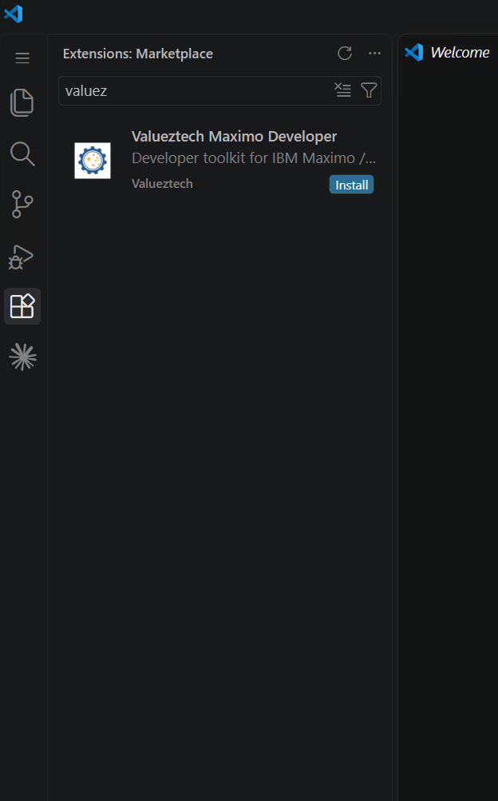

Once installed, the extension page shows **Disable** and **Uninstall**, and a new **Maximo Developer** icon (a cloud with a down arrow) appears in the Activity Bar.

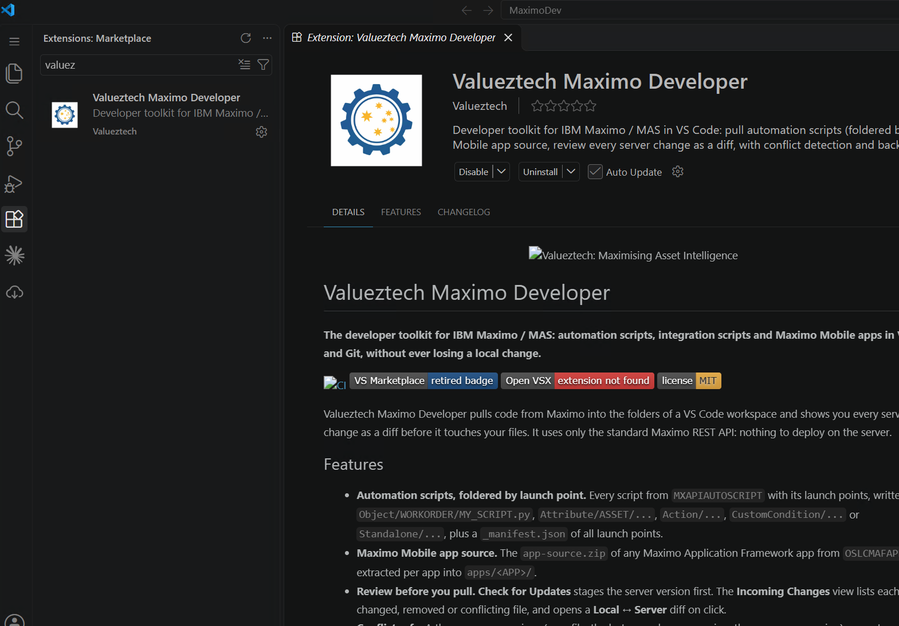

Or install from a terminal:

```bash
code --install-extension valueztech.maximo-developer
```

## 2. Open the Maximo Developer view

Click the **Maximo Developer** icon in the Activity Bar. With no project folders set up yet, the view offers two buttons: **Create Sync Config** and **Set API Key**.

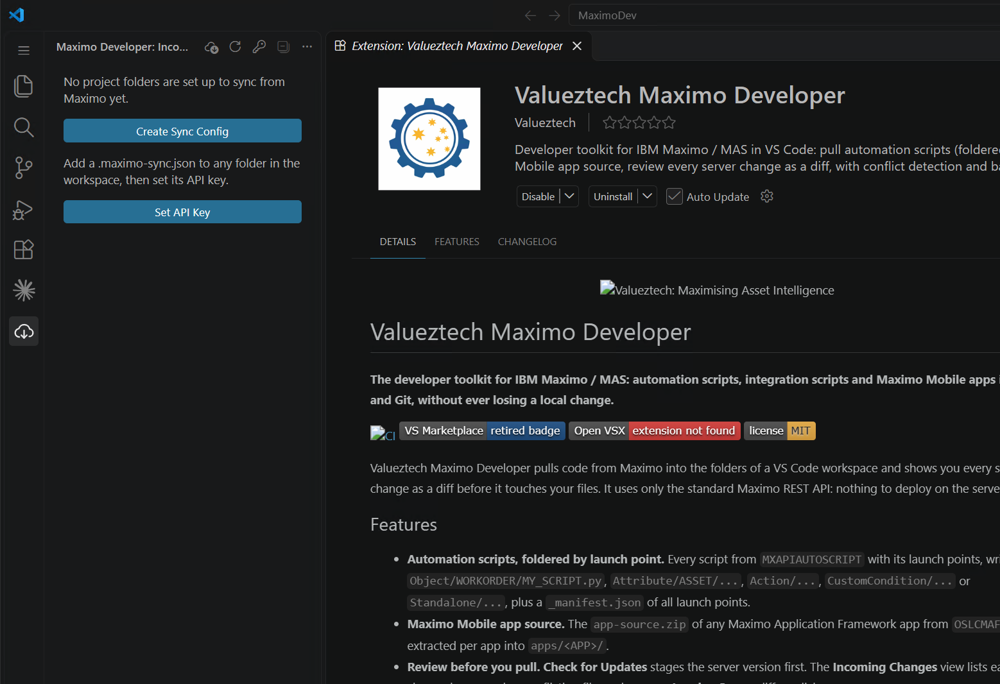

## 3. Store your API key

Click **Set API Key** (or run **Maximo Developer: Set API Key** from the Command Palette).

**a. Name the key.** The default is `maximo-dev`. This name is what `server.apiKeySecret` in `.maximo-sync.json` refers to. Use one name per environment, e.g. `maximo-dev`, `maximo-test`, `maximo-prod`. Press **Enter**.

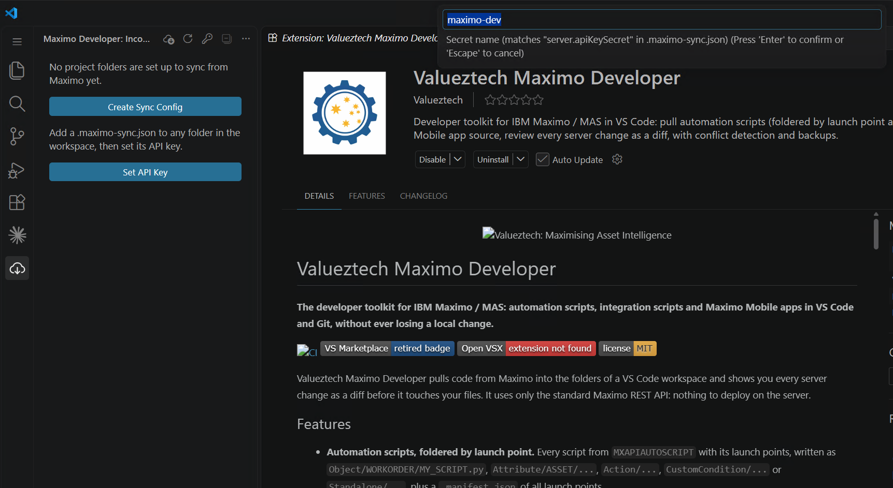

**b. Paste the API key** and press **Enter**. The key is stored in your operating system keychain through VS Code SecretStorage. It is never written to the project or committed to Git.

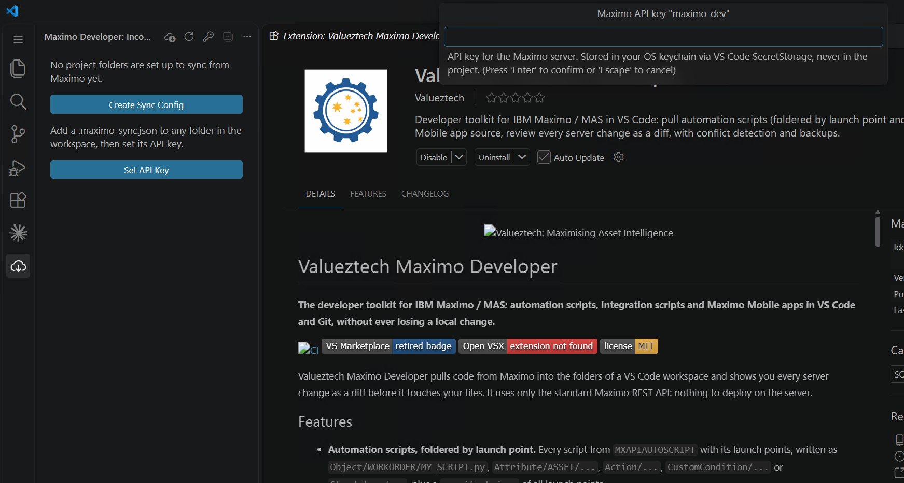

A notification confirms the key was saved.

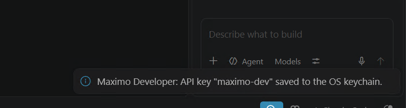

> In CI or on a shared build machine, set an environment variable instead and name it in `server.apiKeyEnv`. The variable is checked before the keychain.

## 4. Create a sync config

Click **Create Sync Config** in the view (or right-click a folder in the Explorer and choose **Create Sync Config in Folder**).

**a. Pick the project folder** that should sync from Maximo, or choose **Browse...** for another one.

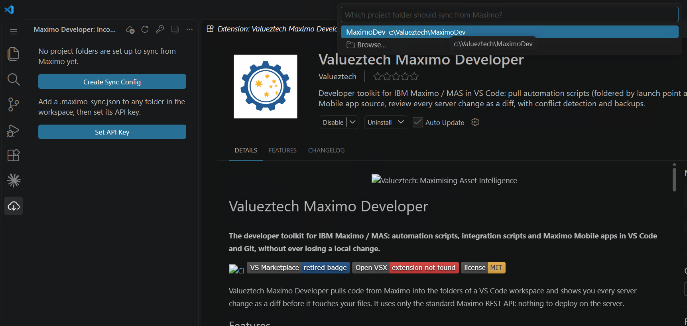

**b. Choose what the folder gets from Maximo:**

| Option | What you get |
|---|---|
| **Automation scripts** | Every script from `MXAPIAUTOSCRIPT`, foldered by launch point type and object |
| **Mobile app source** | The `app-source.zip` of a Maximo Mobile (MAF) app, extracted |
| **Records from any object structure** | One file per record, from an attribute you choose |
| **Zip download** | Any URL that returns a zip |

This guide uses **Automation scripts**.

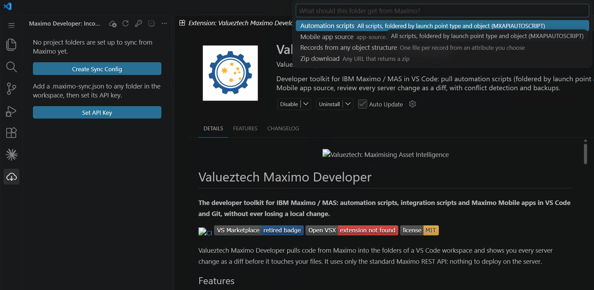

The extension writes `.maximo-sync.json` into the folder, opens it, and adds `.maximo-sync/` to `.gitignore`. The view now lists the source as **not checked yet**.

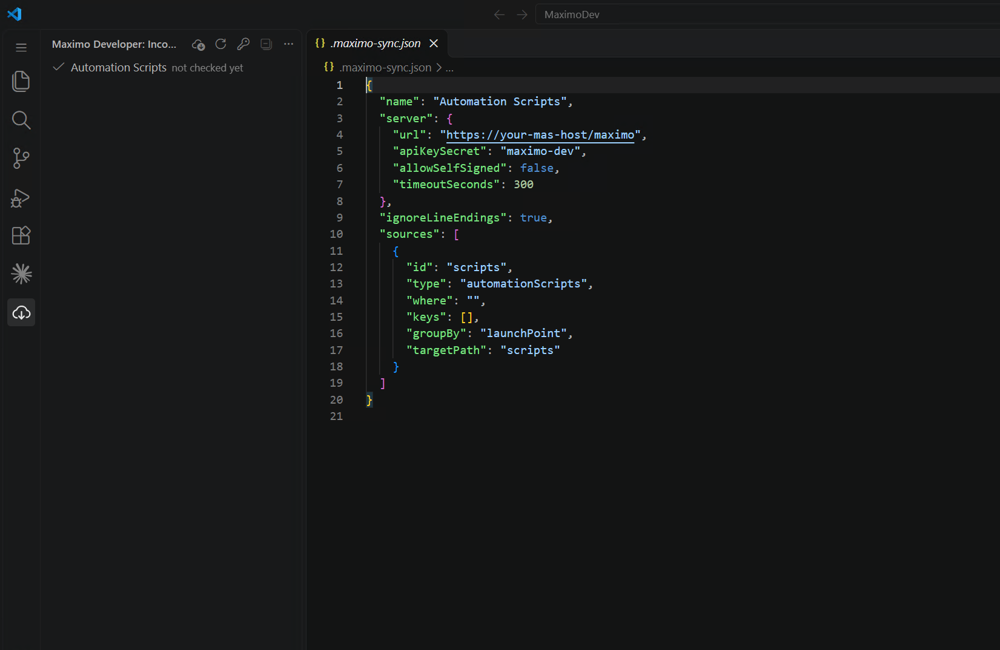

## 5. Point it at your server

Replace the placeholder `server.url` with your Maximo context root (it normally ends in `/maximo`) and save the file. Check that `apiKeySecret` matches the key name from step 3.

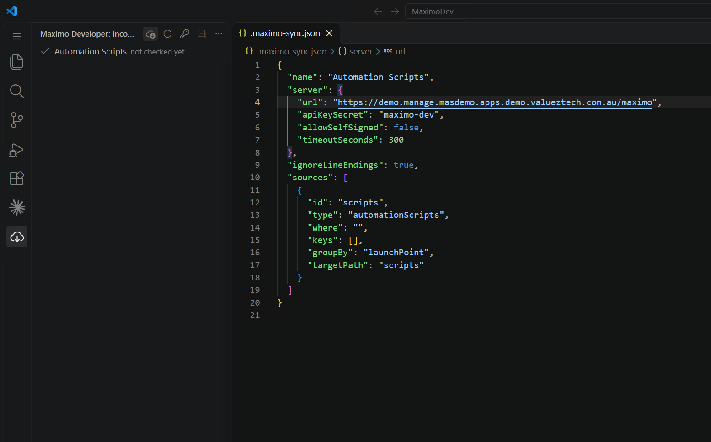

```jsonc
{
  "name": "Automation Scripts",
  "server": {
    "url": "https://mas.example.com/maximo",
    "apiKeySecret": "maximo-dev",
    "allowSelfSigned": false,
    "timeoutSeconds": 300
  },
  "ignoreLineEndings": true,
  "sources": [
    {
      "id": "scripts",
      "type": "automationScripts",
      "where": "",          // optional OSLC filter, e.g. autoscript="VZ_%"
      "keys": [],           // optional list of script names
      "groupBy": "launchPoint",
      "targetPath": "scripts"
    }
  ]
}
```

## 6. Check for updates

Click **Check for Updates** (the cloud icon at the top of the view). Nothing is written to your files at this stage: the server version is staged for review first. Progress and errors go to the **Output** panel, channel **Maximo Developer**.

### Self-signed certificate error

Non-production MAS clusters often use a self-signed certificate. The check then fails with a red icon and this message in the Output panel:

```
ERROR self signed certificate in certificate chain. If this is a non-production
server with a self-signed certificate, set "allowSelfSigned": true in the server block.
```

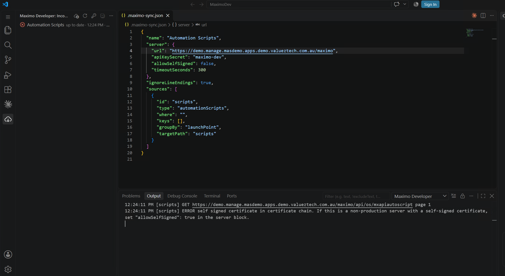

Set `"allowSelfSigned": true` in the `server` block, save, and check again. Leave it `false` for production servers with a trusted certificate.

### Successful check

The log shows each page read, how many scripts have launch points, and a count by type. A notification reports the number of incoming changes, with **Review Changes** and **Apply Non-conflicting** buttons.

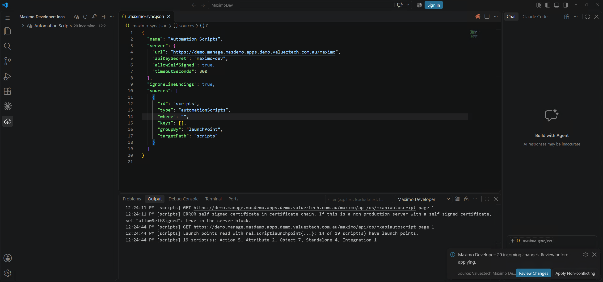

## 7. Review the incoming changes

Expand the source in the view. Each file shows its target path and status (`new on server`, `changed on server`, `removed on server` or `conflict`). Click any file to open a **Local ↔ Server** diff.

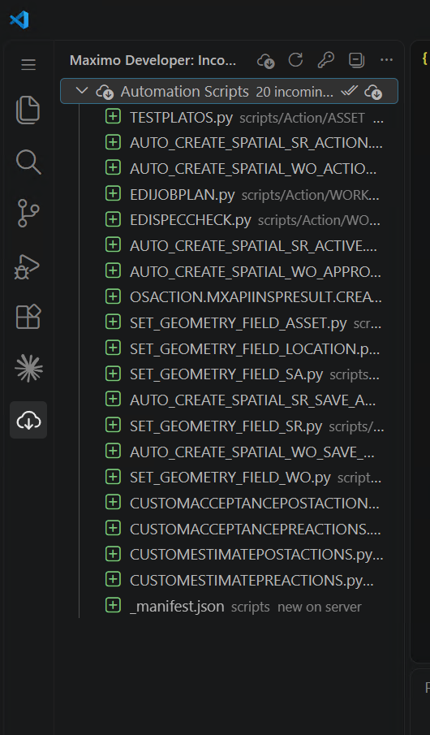

## 8. Apply

Accept files one at a time from their context menu, or click **Apply All Non-conflicting** (the double tick on the source row) and confirm. Files you edited locally are never overwritten, and anything replaced or removed is backed up to `.maximo-sync/backups/<timestamp>/` first.

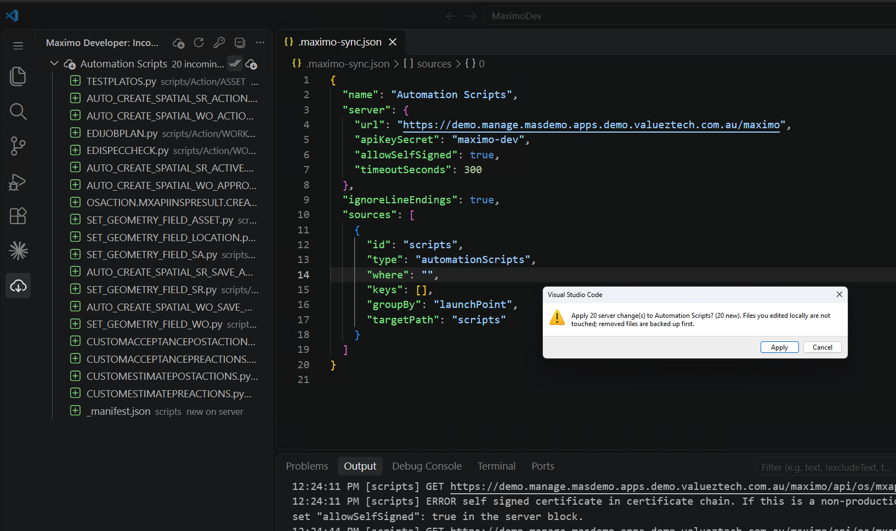

## 9. Done: your scripts on disk

The scripts are now in the folder, grouped by launch point type and object:

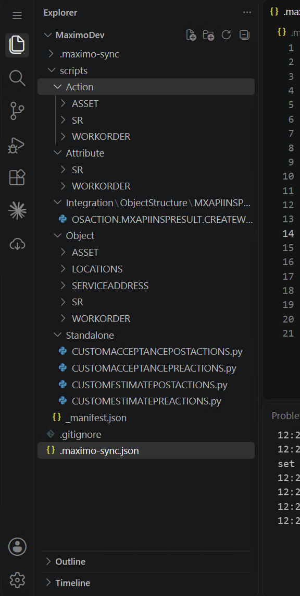

```
scripts/
  Action/ASSET | SR | WORKORDER/...
  Attribute/SR | WORKORDER/...
  Integration/ObjectStructure/MXAPIINSPRESULT/OSACTION.MXAPIINSPRESULT.CREATEWO.py
  Object/ASSET | LOCATIONS | SERVICEADDRESS | SR | WORKORDER/...
  Standalone/CUSTOMACCEPTANCEPOSTACTIONS.py ...
  _manifest.json        every script with all of its launch points
.maximo-sync/           local state and backups (kept out of Git)
.maximo-sync.json       this folder's sync config
```

Commit the folder to Git. From now on, **Check for Updates** shows only what changed on the server since your last sync.

---

## Next steps

- **More environments or projects.** Add another folder with its own `.maximo-sync.json` and API key name. Each folder can point at a different server.
- **Maximo Mobile app source.** Create a sync config with **Mobile app source** and set `app` (e.g. `TECHMOBILE`).
- **Filter scripts.** Use `where` (e.g. `autoscript="VZ_%"`) or `keys` to sync only some scripts.
- **Background checks.** Set `maximoSync.checkOnStartup` or `maximoSync.checkIntervalMinutes`. Checks never change files; they notify you.
- **Every option** is in the [configuration reference](../README.md#configuration-reference-maximo-syncjson).

## Troubleshooting

| Symptom | Fix |
|---|---|
| `self signed certificate in certificate chain` | Non-production only: set `"allowSelfSigned": true` in `server` |
| `401` / `403` | Wrong or expired key, or the key name does not match `apiKeySecret`. Run **Set API Key** again. Check the account can read `MXAPIAUTOSCRIPT` |
| `404` on `/api/os/mxapiautoscript` | `server.url` must be the context root ending in `/maximo`, not the MAS home page |
| Timeout | Raise `server.timeoutSeconds`, or narrow the pull with `where` |
| Every file shows as `conflict` on first sync | The folder already had files that differ from the server. Review each diff, then **Accept Server Version** or **Keep Local Version** |

Need help? Email **support@valueztech.com** or raise an issue at <https://github.com/Valueztech-Australia/maximo-developer-docs/issues>.

---

**Valueztech** · Maximising Asset Intelligence · [www.valueztech.com](https://www.valueztech.com)
